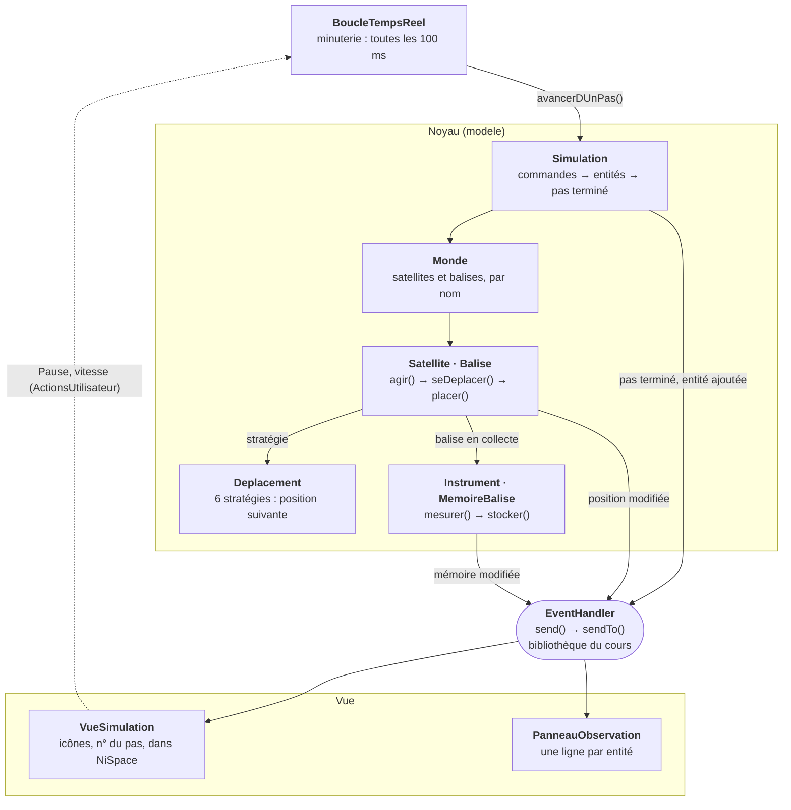

# Satellites et balises

Une simulation pas à pas : des satellites et des balises bougent, et l'écran les montre sans que le modèle
connaisse l'écran. Tout le reste du projet (mesures, remontée, transmission, langage, sauvegarde) se greffe
sur ce noyau sans le casser.

Projet de M1 TIIL-A, UBO. Java 17, IntelliJ IDEA, bibliothèques du cours (EventHandler, Nicellipse).

---

## Démarrer

1. Ouvrir le dossier `projet-satellites-balises` dans IntelliJ IDEA.
2. JDK 17 : IntelliJ le configure tout seul grâce à `.sdkmanrc`, ou propose de le télécharger.
3. Lancer **« Lancer l'application »** : la fenêtre s'ouvre et le temps défile.
4. Lancer **« Tous les tests »** : tout doit être au vert.

Pour activer les tests d'une nouvelle étape : clic droit sur `satellites-balises/tests/etapeN`
→ *Mark Directory as* → *Test Sources Root*.

---

## Ce que fait le noyau aujourd'hui

Étapes 1 à 4 terminées, 134 tests automatiques au vert.

- **Un monde rectangle** : le ciel au-dessus de la surface (y > 0), la mer en dessous (y ≤ 0).
- **Le temps avance pas par pas**, avec pause, reprise et vitesse réglable.
- **Des commandes datées** s'exécutent au début du pas prévu ; une commande impossible est ignorée et
  signalée, la simulation continue.
- **Une fabrique crée les entités** et refuse ce qui est faux : satellite dans la mer, balise dans le ciel,
  valeur ≤ 0, nom déjà pris.
- **Six déplacements** : immobile, géostationnaire et orbital pour les satellites ; horizontal, vertical et
  sinusoïdal pour les balises. Une entité ne sort jamais de sa zone.
- **Des instruments mesurent l'océan** : température, salinité, turbidité, courant (vitesse et direction).
  Les valeurs viennent d'un océan simulé commun : deux balises au même endroit mesurent la même chose.
- **Une mémoire par balise**, de capacité limitée : une balise en collecte y range une mesure par instrument
  et par pas ; mémoire pleine, la mesure est perdue (la remontée arrive à l'étape 5).
- **L'écran** : une icône par entité dans le monde, une ligne par entité dans le panneau de gauche, le numéro
  du pas en haut.

---

## Le croquis

**Le noyau publie, la vue écoute : le noyau ne connaît jamais l'écran.**



La minuterie fait avancer la simulation ; le noyau publie ce qui change à l'EventHandler, qui prévient la vue.
Seul le clic sur Pause remonte de la vue vers la minuterie (pointillés). Aucune flèche ne va du noyau vers la vue.

---

## Les classes principales

| Classe | Paquetage | Son rôle en une ligne |
| --- | --- | --- |
| `Simulation` | modele.simulation | Fait avancer le temps : un pas = commandes prévues, entités qui agissent, « pas terminé » |
| `BoucleTempsReel` | application | Minuterie Swing qui appelle `avancerDUnPas()` toutes les 100 ms |
| `Monde` | modele.monde | La géométrie, plus les satellites et les balises rangés par nom |
| `GeometrieMonde` | modele.monde | Dimensions ; dit si une position est dans le ciel, dans la mer, dans le monde |
| `Entite`, `Satellite`, `Balise` | modele.entite | Nom, position, déplacement, apparence ; `agir()` à chaque pas |
| `Deplacement` (6 variantes) | modele.deplacement | Stratégie : donne la position du pas suivant |
| `Instrument`, `MemoireBalise` | modele.mesure | Un instrument mesure, la mémoire range les mesures (capacité limitée) |
| `EnvironnementSimule` | modele.mesure | L'océan commun : la valeur de chaque grandeur, partout et à chaque pas |
| `FabriqueEntites` + 2 monteurs | modele.creation | Crée une entité valide, ou refuse avec un message clair |
| `EventHandler` | eventHandler (cours) | Transporte chaque événement du modèle vers ses abonnés |
| `VueSimulation` | vue | La fenêtre : s'abonne aux événements et redessine |
| `PanneauObservation` | vue | Une ligne par entité, à gauche de l'écran |
| `Application` | application | Assemble tout au démarrage |

---

## Un pas de simulation

Chaque pas suit toujours le même ordre, dans `Simulation.avancerDUnPas()` :

1. Le numéro du pas augmente de 1.
2. Les commandes prévues pour ce pas s'exécutent, dans l'ordre où elles ont été planifiées.
3. Chaque satellite, puis chaque balise, agit : `agir()` → `seDeplacer()` → `placer()`.
   Si la position a changé, l'entité publie « position modifiée ». Une balise en collecte mesure
   ensuite avec chacun de ses instruments et publie « mémoire modifiée ».
4. Les communications avanceront ici (étape 6).
5. La simulation publie « pas terminé » : la vue affiche le nouveau numéro.

Tout se passe sur le fil d'affichage Swing : un clic sur Pause tombe toujours entre deux pas, jamais au milieu.

---

## Les événements

Le modèle publie, la vue écoute. C'est l'`EventHandler` du cours qui fait le lien, en trois gestes.

```java
// 1. S'abonner : la vue, une fois, au démarrage
eventHandler.registerListener(EvenementPositionModifiee.class, vue);

// 2. Publier : le modèle, quand quelque chose change
eventHandler.send(new EvenementPositionModifiee(this));

// 3. Recevoir : l'événement appelle lui-même la bonne méthode de l'abonné
public void sendTo(Object ecouteur) {
    ((EcouteurEntites) ecouteur).positionModifiee(this);
}
```

| Événement | Publié par | Écouté par | Ce qu'on voit |
| --- | --- | --- | --- |
| `EvenementPasTermine` | `Simulation` | `VueSimulation` | Le numéro du pas change |
| `EvenementEntiteAjoutee` | `Simulation.ajouter` | `VueSimulation`, `PanneauObservation` | Une icône et une ligne apparaissent |
| `EvenementEntiteSupprimee` | `Simulation.supprimer` | `VueSimulation`, `PanneauObservation` | L'icône et la ligne disparaissent |
| `EvenementPositionModifiee` | `Entite.placer` | `VueSimulation` | L'icône se déplace |
| `EvenementApparenceModifiee` | `CommandeChangerApparence` | `VueSimulation` | Taille ou couleur changent |
| `EvenementMemoireModifiee` | `Balise.mesurer` | `PanneauObservation` | La mémoire de la balise se remplit |
| `EvenementEquipementModifie` | `CommandeEquiper`, `CommandeDesequiper` | `PanneauObservation` | La liste des instruments change |
| `EvenementCommandeIgnoree` | Les commandes | Panneau de commandes (étape 7) | Le message d'erreur |

La preuve que ça marche : le panneau de gauche a été ajouté comme un abonné de plus, sans changer une seule
ligne du modèle.

---

## La démo

1. Lancer **« Lancer l'application »** : ciel blanc, mer bleue, numéro du pas qui défile.
2. **Pause**, puis **Reprendre**, puis le curseur de vitesse : le temps se contrôle.
3. Les satellites : s1 et s2 tournent et reviennent par la gauche ; s3, géostationnaire, ne bouge pas.
4. Les balises : b1 va et vient, b2 monte et descend, b3 ondule, b4 reste immobile. Aucune ne sort de la mer.
5. Le panneau de gauche : une ligne par entité, ajoutée en même temps que son icône. La mémoire des
   balises se remplit : b1 (2 instruments, T S) atteint 50/50 au pas 25 ; b4, sans instrument, reste à 0.
6. Lancer **« Tous les tests »** : 134 tests au vert.
7. Conclure : ajouter un affichage, c'est ajouter un abonné ; le modèle ne change pas.

Les entités de la démo sont créées dans `Application.ajouterEntitesDeDemonstration()`.
Le langage de commandes les remplacera à l'étape 7.

---

## Avancement

| Étape | Contenu | État |
| --- | --- | --- |
| 1 | Monde, temps, événements, décor | ✅ |
| 2 | Entités, fabrique, catalogues, panneau d'observation | ✅ |
| 3 | Déplacements des balises et des satellites | ✅ |
| 4 | Instruments, mesures, mémoire | ✅ |
| 5 | Cycle d'activités de la balise | ⏳ |
| 6 | Satellites et communication | ⏳ |
| 7 | Langage de commandes | ⏳ |
| 8 | Sauvegarde et reprise | ⏳ |
| 9 | Démonstrations, tests d'intégration, documentation | ⏳ |

Les exigences détaillées et leur suivi sont dans le Google Doc des exigences. Le dossier de conception
complet (diagrammes UML par composant) est à part ; les diagrammes de classes seront ajoutés ici au fil
des étapes.
