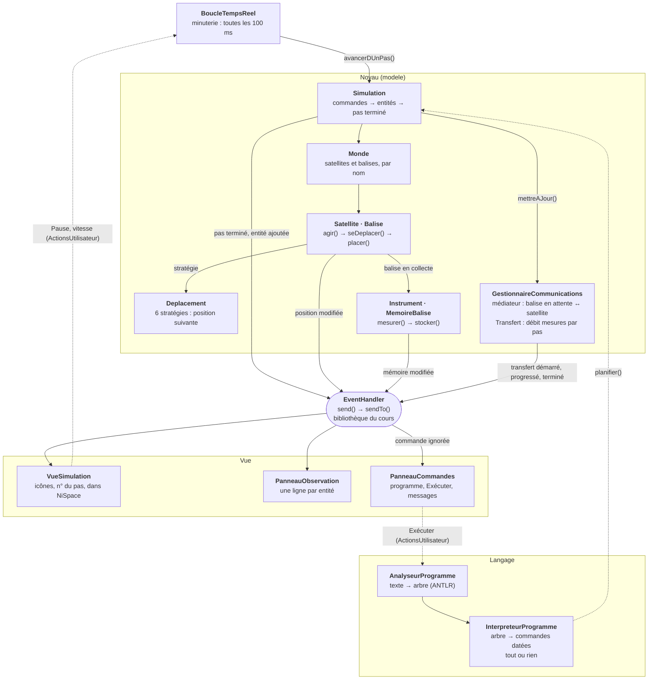

# Satellites et balises

Une simulation pas à pas : des satellites et des balises bougent, et l'écran les montre sans que le modèle
connaisse l'écran. Tout le reste du projet (mesures, remontée, transmission, langage, sauvegarde) se greffe
sur ce noyau sans le casser.

Projet de M1 TIIL-A, UBO. Java 17, IntelliJ IDEA, bibliothèques du cours (EventHandler, Nicellipse).

---

## Démarrer

1. Ouvrir le dossier `projet-satellites-balises` dans IntelliJ IDEA.
2. JDK 17 : IntelliJ le configure tout seul grâce à `.sdkmanrc`, ou propose de le télécharger.
3. Lancer **« Lancer l'application »** : la fenêtre s'ouvre et le temps défile.
4. Lancer **« Tous les tests »** : tout doit être au vert.

Pour activer les tests d'une nouvelle étape : clic droit sur `satellites-balises/tests/etapeN`
→ *Mark Directory as* → *Test Sources Root*.

---

## Ce que fait le noyau aujourd'hui

Étapes 1 à 7 terminées, 227 tests automatiques au vert.

- **Un monde rectangle** : le ciel au-dessus de la surface (y > 0), la mer en dessous (y ≤ 0).
- **Le temps avance pas par pas**, avec pause, reprise et vitesse réglable.
- **Des commandes datées** s'exécutent au début du pas prévu ; une commande impossible est ignorée et
  signalée, la simulation continue.
- **Une fabrique crée les entités** et refuse ce qui est faux : satellite dans la mer, balise dans le ciel,
  valeur ≤ 0, nom déjà pris.
- **Six déplacements** : immobile, géostationnaire et orbital pour les satellites ; horizontal, vertical et
  sinusoïdal pour les balises. Une entité ne sort jamais de sa zone.
- **Des instruments mesurent l'océan** : température, salinité, turbidité, courant (vitesse et direction).
  Les valeurs viennent d'un océan simulé commun : deux balises au même endroit mesurent la même chose.
- **Une mémoire par balise**, de capacité limitée : une balise en collecte y range une mesure par instrument
  et par pas ; mémoire pleine, la mesure est perdue.
- **Le cycle de la balise** : Collecte → Remontée → Attente → Transmission → Descente → Collecte. La remontée
  se déclenche quand la mémoire est pleine, après une durée, ou sur demande ; la balise monte tout droit,
  attend un satellite à la surface, puis redescend collecter à sa profondeur de travail.
- **Les satellites reçoivent les mesures** : une balise en attente est servie par le satellite disponible le
  plus proche qui la couvre (|Δx| ≤ portée). Le transfert dure plusieurs pas, « débit » mesures par pas, sans
  perte ni doublon ; il est rompu si le satellite s'éloigne ou s'arrête, et la balise garde le reste.
- **Arrêter, redémarrer, configurer** : un satellite peut être mis hors service ; portée, débit, mémoire et
  vitesse verticale se changent par commande (une capacité trop petite est refusée).
- **Un langage de commandes** : on décrit une campagne dans un petit programme texte (créer, déplacer,
  équiper, attendre, arrêter…). Il est vérifié en entier avant d'agir : la moindre erreur est signalée
  avec sa ligne, et rien n'est planifié. Sinon, chaque ligne devient une commande datée.
- **L'écran** : une icône par entité dans le monde, et deux onglets à gauche : « Observation » (une ligne
  par entité) et « Commandes » (le programme, le bouton Exécuter, les messages). Le numéro du pas en haut.

---

## Le croquis

**Le noyau publie, la vue écoute : le noyau ne connaît jamais l'écran.**



La minuterie fait avancer la simulation ; le noyau publie ce qui change à l'EventHandler, qui prévient la vue.
Seuls les clics remontent de la vue (pointillés) : Pause vers la minuterie, Exécuter vers le langage, qui
planifie des commandes dans la simulation. Aucune flèche ne va du noyau vers la vue ou vers le langage.

---

## Les classes principales

| Classe | Paquetage | Son rôle en une ligne |
| --- | --- | --- |
| `Simulation` | modele.simulation | Fait avancer le temps : un pas = commandes prévues, entités qui agissent, « pas terminé » |
| `BoucleTempsReel` | application | Minuterie Swing qui appelle `avancerDUnPas()` toutes les 100 ms |
| `Monde` | modele.monde | La géométrie, plus les satellites et les balises rangés par nom |
| `GeometrieMonde` | modele.monde | Dimensions ; dit si une position est dans le ciel, dans la mer, dans le monde |
| `Entite`, `Satellite`, `Balise` | modele.entite | Nom, position, déplacement, apparence ; `agir()` à chaque pas |
| `Deplacement` (6 variantes) | modele.deplacement | Stratégie : donne la position du pas suivant |
| `Instrument`, `MemoireBalise` | modele.mesure | Un instrument mesure, la mémoire range les mesures (capacité limitée) |
| `EnvironnementSimule` | modele.mesure | L'océan commun : la valeur de chaque grandeur, partout et à chaque pas |
| `Activite` (5 états) | modele.activite | Ce que fait la balise en ce moment ; chaque état choisit le suivant (patron État) |
| `ConditionRemontee` | modele.activite | Quand remonter : mémoire pleine, durée, ou les deux (« ou ») |
| `GestionnaireCommunications` | modele.communication | Médiateur : associe chaque balise en attente au satellite le plus proche |
| `Transfert` | modele.communication | Fait passer « débit » mesures par pas de la balise à l'archive du satellite |
| `FabriqueEntites` + 2 monteurs | modele.creation | Crée une entité valide, ou refuse avec un message clair |
| `EventHandler` | eventHandler (cours) | Transporte chaque événement du modèle vers ses abonnés |
| `VueSimulation` | vue | La fenêtre : s'abonne aux événements et redessine |
| `PanneauObservation` | vue | Une ligne par entité, à gauche de l'écran |
| `PanneauCommandes` | vue | Onglet « Commandes » : le programme, le bouton Exécuter, les messages |
| `AnalyseurProgramme` | langage.analyse | Texte → arbre abstrait, avec le lexer et le parser générés par ANTLR |
| `Programme`, `Instruction` (9 sortes) | langage.arbre | L'arbre abstrait : une classe par instruction, sans ANTLR ni modèle |
| `InterpreteurProgramme` | langage.interpretation | Visiteur : vérifie tout, puis planifie les commandes (tout ou rien) |
| `Application` | application | Assemble tout au démarrage |

---

## Un pas de simulation

Chaque pas suit toujours le même ordre, dans `Simulation.avancerDUnPas()` :

1. Le numéro du pas augmente de 1.
2. Les commandes prévues pour ce pas s'exécutent, dans l'ordre où elles ont été planifiées.
3. Chaque satellite, puis chaque balise, agit : `agir()` → `seDeplacer()` → `placer()`.
   Si la position a changé, l'entité publie « position modifiée ». Une balise confie son pas à son
   activité : en collecte, elle mesure puis vérifie sa condition de remontée ; en remontée ou en
   descente, elle monte ou descend tout droit. Chaque changement d'activité publie « activité modifiée ».
4. Les communications : les transferts en cours avancent (ou sont rompus), puis chaque balise en attente
   est associée au satellite disponible le plus proche. Un transfert créé à ce pas n'envoie rien avant
   le pas suivant.
5. La simulation publie « pas terminé » : la vue affiche le nouveau numéro.

Tout se passe sur le fil d'affichage Swing : un clic sur Pause tombe toujours entre deux pas, jamais au milieu.

---

## Les événements

Le modèle publie, la vue écoute. C'est l'`EventHandler` du cours qui fait le lien, en trois gestes.

```java
// 1. S'abonner : la vue, une fois, au démarrage
eventHandler.registerListener(EvenementPositionModifiee.class, vue);

// 2. Publier : le modèle, quand quelque chose change
eventHandler.send(new EvenementPositionModifiee(this));

// 3. Recevoir : l'événement appelle lui-même la bonne méthode de l'abonné
public void sendTo(Object ecouteur) {
    ((EcouteurEntites) ecouteur).positionModifiee(this);
}
```

| Événement | Publié par | Écouté par | Ce qu'on voit |
| --- | --- | --- | --- |
| `EvenementPasTermine` | `Simulation` | `VueSimulation` | Le numéro du pas change |
| `EvenementEntiteAjoutee` | `Simulation.ajouter` | `VueSimulation`, `PanneauObservation` | Une icône et une ligne apparaissent |
| `EvenementEntiteSupprimee` | `Simulation.supprimer` | `VueSimulation`, `PanneauObservation` | L'icône et la ligne disparaissent |
| `EvenementPositionModifiee` | `Entite.placer` | `VueSimulation` | L'icône se déplace |
| `EvenementApparenceModifiee` | `CommandeChangerApparence` | `VueSimulation` | Taille ou couleur changent |
| `EvenementMemoireModifiee` | `Balise.mesurer` | `PanneauObservation` | La mémoire de la balise se remplit |
| `EvenementActiviteModifiee` | `Balise.changerActivite` | `PanneauObservation` | L'activité de la balise change |
| `EvenementStatutModifie` | Commandes, communications | `VueSimulation`, `PanneauObservation` | Satellite grisé « (HS) », statut dans le panneau |
| `EvenementTransfertDemarre` | `GestionnaireCommunications` | `VueSimulation`, `PanneauObservation` | Cercles orange autour du satellite et de la balise |
| `EvenementTransfertProgresse` | `Transfert` | `PanneauObservation` | Le pourcentage du transfert augmente |
| `EvenementTransfertTermine` | `Transfert` | `VueSimulation`, `PanneauObservation` | Les cercles disparaissent |
| `EvenementEquipementModifie` | `CommandeEquiper`, `CommandeDesequiper` | `PanneauObservation` | La liste des instruments change |
| `EvenementCommandeIgnoree` | Les commandes | `PanneauCommandes` | « Commande ignorée : … » dans les messages |

La preuve que ça marche : le panneau de gauche a été ajouté comme un abonné de plus, sans changer une seule
ligne du modèle.

---

## La démo

1. Lancer **« Lancer l'application »** : ciel blanc, mer bleue, numéro du pas qui défile.
2. **Pause**, puis **Reprendre**, puis le curseur de vitesse : le temps se contrôle.
3. Les satellites : s1 et s2 tournent et reviennent par la gauche ; s3, géostationnaire, ne bouge pas.
4. Les balises : b1 va et vient, b2 monte et descend, b3 ondule, b4 reste immobile. Aucune ne sort de la mer.
5. Le panneau de gauche : une ligne par entité, ajoutée en même temps que son icône. La mémoire des
   balises se remplit : b1 (2 instruments, T S) atteint 50/50 au pas 25 ; b4, sans instrument, reste à 0.
6. Le cycle : b1 pleine au pas 25 passe en Remontée et atteint la surface vers le pas 50 (Attente) ;
   b4 remonte au bout de 60 pas de collecte, même vide.
7. Les transferts : quand s1 (débit 1) passe au-dessus d'une balise en attente, des cercles orange
   apparaissent, le pourcentage monte dans le panneau et l'archive de s1 grossit ; la balise redescend ensuite.
   s2 est arrêté du pas 150 au pas 300 : il est grisé, marqué « (HS) », et ne reçoit rien.
8. L'onglet **Commandes** : le programme de la démo est affiché ; en écrire un autre (ou **Ouvrir…** un
   fichier de `exemples/`), puis **Exécuter**. Une erreur est signalée avec sa ligne, et rien n'est planifié.
9. Lancer **« Tous les tests »** : 227 tests au vert.
10. Conclure : ajouter un affichage, c'est ajouter un abonné ; le modèle ne change pas.

La démo est un programme du langage : `exemples/00-demonstration.sb`, chargé et exécuté au démarrage.

---

## Le langage de commandes

Une instruction par ligne ; `--` commence un commentaire. Exemple (`exemples/04-communication.sb`) :

```
satellite s1 en (100, 200) { portee = 60 ; debit = 2 }
deplacement s1 orbital(vitesse = 3)
balise b1 en (150, -40) { memoire = 15 ; vitesseVerticale = 4 }
equiper b1 temperature()
attendre 200
arreter s1            -- panne : le satellite est hors service
attendre 100
demarrer s1
remonter b1           -- remontée forcée
```

| Instruction | Exemple |
| --- | --- |
| Créer | `satellite s1 en (0, 200) { portee = 40 ; debit = 3 }` · `balise b1 en (120, -80)` |
| Supprimer, configurer | `supprimer b2` · `configurer s2 { portee = 60 }` |
| Déplacement, remontée | `deplacement b1 sinusoidal(amplitude = 15, periode = 60)` · `remontee b1 duree(pas = 150)` |
| Équiper, déséquiper | `equiper b1 temperature(), salinite()` · `desequiper b1 turbidite` |
| Ordres | `arreter s1` · `demarrer s1` · `remonter b1` |
| Apparence, temps | `apparence b1 { couleur = "orange" ; taille = 14 }` · `attendre 200` |

**Comment un programme devient des commandes :**

```
texte ──► AnalyseurProgramme (ANTLR) ──► Programme (arbre) ──► InterpreteurProgramme ──► commandes datées
           erreur de syntaxe :                                  erreur de sens :
           ligne et colonne                                     ligne et explication
```

- **Dates** : la première commande part au pas courant + 1 ; `attendre n` décale de n pas tout ce qui suit.
- **Tout ou rien** : toutes les erreurs sont listées, et un programme qui en contient une ne planifie rien.
- **Extensible** : `orbital`, `temperature`, `duree`… ne sont pas des mots-clés ; ils sont cherchés dans les
  catalogues du modèle. Un nouvel instrument ou déplacement ne change ni la grammaire ni l'interpréteur.
- **La grammaire** est dans `src/satellitesbalises/langage/analyse/SatellitesBalises.g4` ; le code généré par
  ANTLR 4.13.2 est dans `langage/analyse/genere/` (déjà généré : rien à installer). Pour la modifier, voir le
  mode d'emploi dans `langage/analyse/package-info.java`.
- **Bibliothèque** : `antlr4-runtime` 4.13.2, déclarée dans le module ; IntelliJ la télécharge à l'ouverture.

---

## Avancement

| Étape | Contenu | État |
| --- | --- | --- |
| 1 | Monde, temps, événements, décor | ✅ |
| 2 | Entités, fabrique, catalogues, panneau d'observation | ✅ |
| 3 | Déplacements des balises et des satellites | ✅ |
| 4 | Instruments, mesures, mémoire | ✅ |
| 5 | Cycle d'activités de la balise | ✅ |
| 6 | Satellites et communication | ✅ |
| 7 | Langage de commandes | ✅ |
| 8 | Sauvegarde et reprise | ⏳ |
| 9 | Démonstrations, tests d'intégration, documentation | ⏳ |

Les exigences détaillées et leur suivi sont dans le Google Doc des exigences. Le dossier de conception
complet (diagrammes UML par composant) est à part ; les diagrammes de classes seront ajoutés ici au fil
des étapes.
